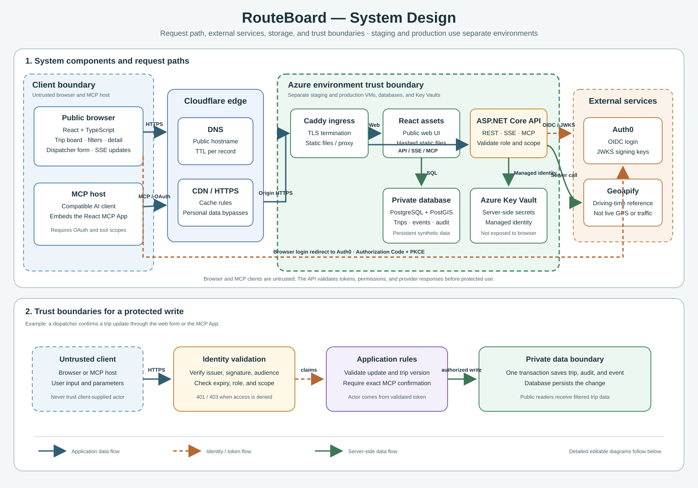
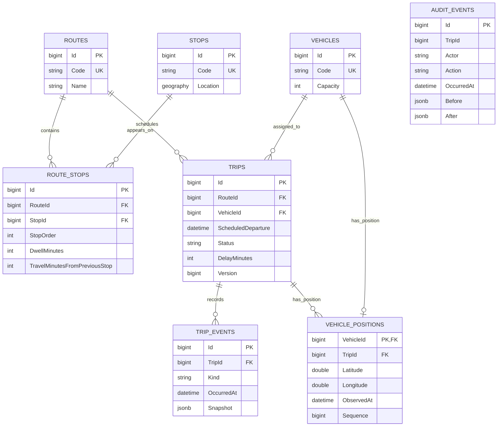
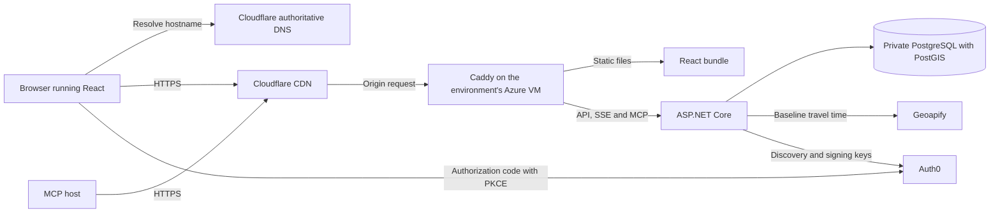
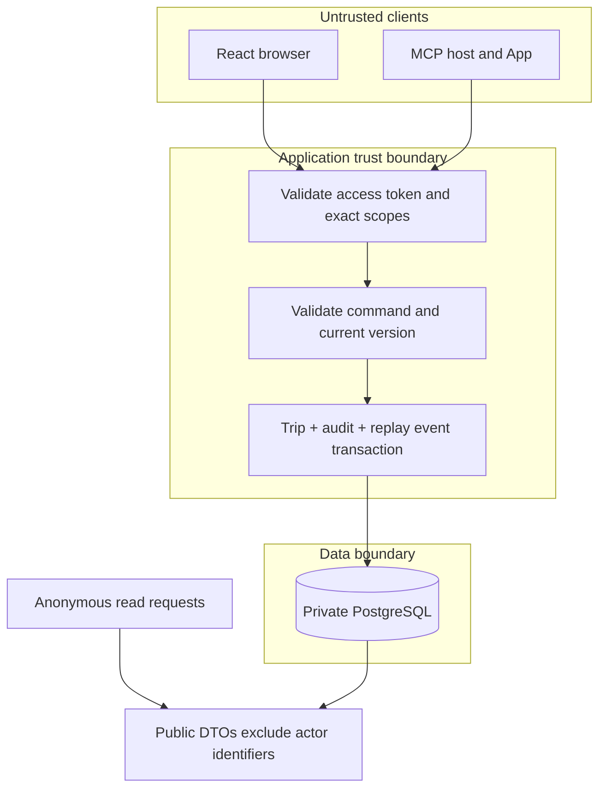

# Architecture and maintenance guide

## Read the code in this order

1. `Program.cs` registers infrastructure, token validation, permissions, middleware, and endpoints.
2. `Controllers/TripsController.cs` handles HTTP input and response status codes.
3. `Features/Trips/TripService.cs` loads data and owns each write transaction.
4. `Features/Trips/TripRules.cs` implements valid state transitions and version checks.
5. `Features/Trips/ArrivalCalculator.cs` contains the small, deterministic ETA calculation.
6. `Data/RouteBoardDbContext.cs` defines relationships, indexes, and database constraints.
7. `Features/Mcp/TripTools.cs` applies tool-specific authorization and calls the same trip service.
8. `frontend/src/App.tsx` renders query state; `DispatchForm.tsx` submits commands; `McpApp.tsx` renders exact-operation confirmation.

The design is a modular monolith. A single student can follow one request without tracing through microservices, a message broker, a generic repository, or an unnecessary mediator. EF Core already provides change tracking and a unit of work. Introduce additional layers only when repeated logic makes them useful.

## Visible system design and trust boundaries

The diagram below is an embedded SVG so it displays as an actual image in common Markdown viewers. It shows the public browser and MCP host, Cloudflare edge, separate Azure environments, application services, private storage, and external providers. The editable Mermaid versions below provide the component and boundary details.

*Figure: RouteBoard system design and trust boundaries. Staging and production are separate copies of the Azure environment. Browser and MCP-host inputs cross into the API boundary, where tokens, roles, scopes, update versions, and provider responses are checked.*

## Database ER diagram and index rationale

`trips(RouteId, ScheduledDeparture)` supports the board's route and departure filtering. `trip_events(TripId, Id)` and `audit_events(TripId, Id)` support ordered per-trip history. Composite unique indexes on `(RouteId, StopOrder)` and `(RouteId, StopId)` prevent duplicate route-stop definitions; the GiST index on stop geography supports spatial lookups. `audit_events.TripId` is only a logical reference: the existing schema does not enforce it with a foreign key, which is a documented limitation.

## Request path and trust boundaries

Staging and production each have their own host, database and Key Vault. DNS returns Cloudflare edge addresses. A cache miss reaches Caddy, which serves static files and forwards application requests to the API. The host retrieves configuration from Key Vault using its managed identity. [DNS evidence](evidence/public-dns/README.md) · [Production deployment](evidence/production-bootstrap/README.md) · [Staging identity flow](evidence/staging-oidc/README.md)

All provider responses and browser/MCP parameters are untrusted. The API never accepts an actor identifier from a request body. It derives `issuer|subject` from a validated token. The database stores no imported user directory or profile.

## Writes, concurrency, and event ordering

The client sends the version it last observed. `TripRules` compares it with the current version. A stale version produces 409. EF also treats `Version` as a concurrency token. A transaction saves the changed trip, before/after audit, and public event snapshot atomically; rollback prevents a misleading success event.

Every trip writer takes PostgreSQL transaction advisory lock 7218401 before reading and writing. This intentionally serializes dispatch changes for a small educational workload. It guarantees stream event allocation/commit order; a sequence number alone would not guarantee that a smaller ID committed first. At higher volume, measure lock wait and redesign publication rather than silently removing the lock.

The audit table rejects UPDATE, DELETE, and TRUNCATE through a trigger. A database owner can still disable that trigger. Production therefore needs a separate least-privilege runtime role, a separate migration role, and protected backups. This local deployment currently uses the development owner role.

## ETA and state

The calculator adds travel time to each stop, records its arrival, then adds that stop's dwell before the next leg. A delay is a total value, not an increment. Actual simulated departure replaces scheduled departure as the estimate's starting point; delay remains an additional recorded adjustment. Operators must not double-count lateness in both fields.

Scheduled → delayed/running/canceled; running → ordered arrivals/completed/canceled. Arrival requires a recorded departure and the next stop in sequence. Finished trips cannot be changed. A vehicle cannot depart a second running trip.

Synthetic position generation is deliberately simpler than ETA: it starts at the first fixed stop, waits dwell, interpolates the next segment, and clamps at the final stop. It does not model a depot-to-first-stop leg, roads, speed, heading, GPS hardware, riders, or live traffic. It cannot automatically create operational arrival events. That limitation must be stated during the defense.

## Reconnection and caching

SSE publishes committed full trip snapshots with increasing IDs. The server replays IDs after `Last-Event-ID`. The browser ignores already seen IDs and refreshes its query rather than adding delays. Event history currently has no retention policy. Introducing retention requires an explicit expired-cursor snapshot recovery contract first. Each connection polls every two seconds; test capacity before scaling.

Geoapify cache keys include ordered coordinates and drive mode. Fresh results last one hour; the previous result is available for up to 24 hours and marked stale when refresh fails. At most two attempts use two-second deadlines. 429 is not retried. Response size and numeric durations/distances are bounded. Provider URLs contain credentials, so HTTP client logging is disabled for this client; do not add raw request-URL tracing later. Live quota and terms remain to be confirmed. Single-flight refresh and a shared/persistent cache are future scaling work.

Cloudflare fronts both deployed sites. HTML revalidates, hashed assets are immutable, and API/authenticated responses are not shared-cached; SSE and MCP remain dynamic. Staging and production evidence records cache headers, an asset MISS/HIT, conditional 304, signed-in no-store responses, and a staging purge. Recheck the environment-specific cache dossiers before changing edge rules.

Confirmation tokens use ASP.NET Data Protection. Azure replicas need a shared, protected, persisted key ring; the current local default is not a completed multi-replica configuration.

## Migrations and failure handling

Never edit the applied `InitialCoreSchema`. New migrations add trip operations and positions. The rollback test creates a randomly named database, applies all migrations, reverts to zero, and reapplies. It never targets `routeboard_dev`.

REST errors use Problem Details and avoid raw exception text. A provider outage does not stop local schedules or dispatch. Simulator failure records an error category and retries on its next tick. Invalid tokens fail closed; lack of identity configuration never enables writes.

## Safe maintenance exercises

- Change a dwell time in a test fixture and hand-calculate the new ETA before running tests.
- Add a status only after updating `TripRules`, the database check constraint through a new migration, UI filters, and transition tests.
- Add a new MCP tool with its own scope, audit call, server validation, and denial tests.
- Keep an update's total values and version in the snapshot; do not apply replayed deltas twice.
- Run `bash scripts/test.sh` before reviewing a change. Review a migration's `Down` method and test it only in disposable data.

See `requirements-status.md` for unresolved work. This guide describes what exists and labels future controls explicitly.

## Container ingress

Caddy serves the strict React bundle and forwards API/MCP/SSE requests to a private API container. Forwarded scheme and client address are accepted only from the explicitly configured ingress IP. Public callers must not be able to bypass that ingress. SSE responses use Caddy's automatic event-stream flushing so disconnect cancellation remains enabled. Hashed assets are immutable; HTML revalidates; API responses are not shared-cached at Cloudflare.

`deploy/host.bicep` describes a small Linux host with a managed identity, SSH public-key authentication, source-restricted SSH, and web ports. Separate resource groups/hosts provide straightforward staging/production isolation but double fixed host costs. Do not call a compiled template an operational deployment.

## Release and database identities

The explicit `--migrate` command exits after applying versioned migrations. Normal API startup does not migrate. The release process uses the migration credential only for that step and applies explicit table grants afterward. The runtime login cannot modify schema or disable audit protections. The database owner can still bypass those protections; keep its secret outside the API container.

Fresh-volume verification caught two real packaging defects: executable scripts on the local bind mount could not run, and Docker allocated the proxy's fixed IP to a dynamic container. SQL initialization and a separate dynamic address range fixed these. Neither error justifies deleting a persistent environment's database volume.

## Deployed Azure environments

Staging and production run on separate Azure VMs with Caddy ingress, API and PostgreSQL/PostGIS containers, separate Key Vaults, and separate Auth0 API audiences. Each host's managed identity reads only its environment's secrets. A Docker forwarding rule blocks application-container access to Azure metadata. Runtime and migration settings are mounted separately. The root administrator and Docker daemon remain privileged trust boundaries. Production promotion is manual; consult `requirements-status.md` for the remaining D3 evidence limitation.

For a change to MCP permissions, update the identity provider's API permission list, role assignments, TripTools scope checks and transport tests together. Audit entries for preview and record identify which tool was authorized. Authorization evidence alone does not establish that a trip changed; check the committed trip version and event row as well.

### Route observability

The API configures OpenTelemetry in RoutingTelemetry. The ASP.NET listener exports route requests with a bounded tag set. Route result logs carry the active trace and span IDs. The meter counts the four provider outcomes using low-cardinality labels. The console exporter sends all three signals to container logs. There is no separate paid monitoring service. Limit retention according to the host disk budget and inspect usage before increasing sample frequency or enabling high-volume endpoints.

The staging probe is a separate Python process. It injects W3C trace context into a public HTTPS request and records one client span per sample. The workflow summary acts as a per-run dashboard. Keep the seeded route, response schema, SLI definition and runbook aligned when changing route estimation.
