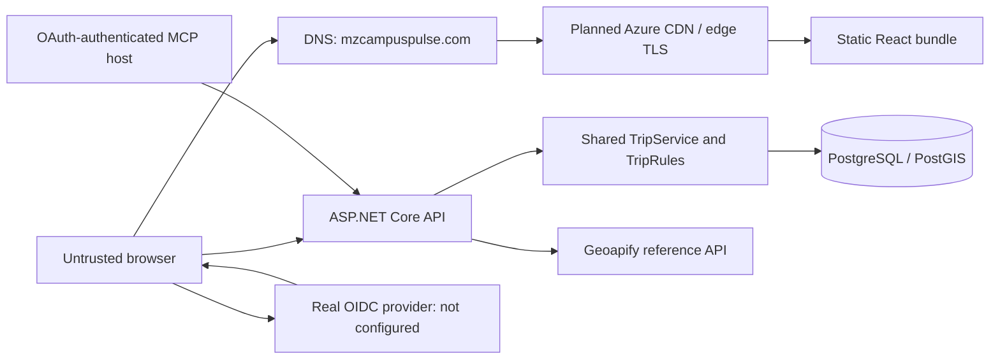
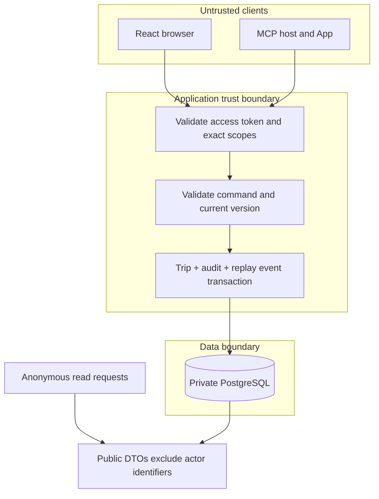

# Architecture and maintenance guide

## Read the code in this order

1. `Program.cs` registers infrastructure, token validation, permissions, middleware, and endpoints.
2. `Controllers/TripsController.cs` handles HTTP input and response status codes.
3. `Features/Trips/TripService.cs` loads data and owns each write transaction.
4. `Features/Trips/TripRules.cs` implements valid state transitions and version checks.
5. `Features/Trips/ArrivalCalculator.cs` contains the small, deterministic ETA calculation.
6. `Data/RouteBoardDbContext.cs` defines relationships, indexes, and database constraints.
7. `Features/Mcp/TripTools.cs` applies tool-specific authorization and calls the same trip service.
8. `frontend/src/App.tsx` renders query state; `DispatchForm.tsx` submits commands; `McpApp.tsx` renders exact-operation confirmation.

The design is a modular monolith. A single student can follow one request without tracing through microservices, a message broker, a generic repository, or an unnecessary mediator. EF Core already provides change tracking and a unit of work. Introduce additional layers only when repeated logic makes them useful.

## Request path and trust boundaries

Cloud components in these diagrams are a target design, not a deployment claim. All provider responses and browser/MCP parameters are untrusted. The API never accepts an actor identifier from a request body. It derives `issuer|subject` from a validated token. The database stores no imported user directory or profile.

## Writes, concurrency, and event ordering

The client sends the version it last observed. `TripRules` compares it with the current version. A stale version produces 409. EF also treats `Version` as a concurrency token. A transaction saves the changed trip, before/after audit, and public event snapshot atomically; rollback prevents a misleading success event.

Every trip writer takes PostgreSQL transaction advisory lock 7218401 before reading and writing. This intentionally serializes dispatch changes for a small educational workload. It guarantees stream event allocation/commit order; a sequence number alone would not guarantee that a smaller ID committed first. At higher volume, measure lock wait and redesign publication rather than silently removing the lock.

The audit table rejects UPDATE, DELETE, and TRUNCATE through a trigger. A database owner can still disable that trigger. Production therefore needs a separate least-privilege runtime role, a separate migration role, and protected backups. This local deployment currently uses the development owner role.

## ETA and state

The calculator adds travel time to each stop, records its arrival, then adds that stop's dwell before the next leg. A delay is a total value, not an increment. Actual simulated departure replaces scheduled departure as the estimate's starting point; delay remains an additional recorded adjustment. Operators must not double-count lateness in both fields.

Scheduled → delayed/running/canceled; running → ordered arrivals/completed/canceled. Arrival requires a recorded departure and the next stop in sequence. Finished trips cannot be changed. A vehicle cannot depart a second running trip.

Synthetic position generation is deliberately simpler than ETA: it starts at the first fixed stop, waits dwell, interpolates the next segment, and clamps at the final stop. It does not model a depot-to-first-stop leg, roads, speed, heading, GPS hardware, riders, or live traffic. It cannot automatically create operational arrival events. That limitation must be stated during the defense.

## Reconnection and caching

SSE publishes committed full trip snapshots with increasing IDs. The server replays IDs after `Last-Event-ID`. The browser ignores already seen IDs and refreshes its query rather than adding delays. Event history currently has no retention policy. Introducing retention requires an explicit expired-cursor snapshot recovery contract first. Each connection polls every two seconds; test capacity before scaling.

Geoapify cache keys include ordered coordinates and drive mode. Fresh results last one hour; the previous result is available for up to 24 hours and marked stale when refresh fails. At most two attempts use two-second deadlines. 429 is not retried. Response size and numeric durations/distances are bounded. Provider URLs contain credentials, so HTTP client logging is disabled for this client; do not add raw request-URL tracing later. Live quota and terms remain to be confirmed. Single-flight refresh and a shared/persistent cache are future scaling work.

HTTP responses currently use `no-store`. A CDN must never override this for authenticated, MCP, SSE, or audit-related content. Proposed policies: HTML revalidate, hashed assets immutable, public API initially bypass, authenticated API no-store. None of the CDN HIT/MISS/304 evidence exists yet.

Confirmation tokens use ASP.NET Data Protection. Azure replicas need a shared, protected, persisted key ring; the current local default is not a completed multi-replica configuration.

## Migrations and failure handling

Never edit the applied `InitialCoreSchema`. New migrations add trip operations and positions. The rollback test creates a randomly named database, applies all migrations, reverts to zero, and reapplies. It never targets `routeboard_dev`.

REST errors use Problem Details and avoid raw exception text. A provider outage does not stop local schedules or dispatch. Simulator failure records an error category and retries on its next tick. Invalid tokens fail closed; lack of identity configuration never enables writes.

## Safe maintenance exercises

- Change a dwell time in a test fixture and hand-calculate the new ETA before running tests.
- Add a status only after updating `TripRules`, the database check constraint through a new migration, UI filters, and transition tests.
- Add a new MCP tool with its own scope, audit call, server validation, and denial tests.
- Keep an update's total values and version in the snapshot; do not apply replayed deltas twice.
- Run `bash scripts/test.sh` before reviewing a change. Review a migration's `Down` method and test it only in disposable data.

See `requirements-status.md` for unresolved work. This guide describes what exists and labels future controls explicitly.

## Container ingress increment

Caddy serves the strict React bundle and forwards API/MCP/SSE requests to a private API container. Forwarded scheme and client address are accepted only from the explicitly configured ingress IP. Public callers must not be able to bypass that ingress. SSE responses use Caddy's automatic event-stream flushing so disconnect cancellation remains enabled. Hashed assets are immutable; HTML revalidates; API responses remain no-store. CDN deployment is still pending.

`deploy/host.bicep` describes a small Linux host with a managed identity, SSH public-key authentication, source-restricted SSH, and web ports. Separate resource groups/hosts provide straightforward staging/production isolation but double fixed host costs. Do not call a compiled template an operational deployment.

## Release and database identities

The explicit `--migrate` command exits after applying versioned migrations. Normal API startup does not migrate. The release process uses the migration credential only for that step and applies explicit table grants afterward. The runtime login cannot modify schema or disable audit protections. The database owner can still bypass those protections; keep its secret outside the API container.

Fresh-volume verification caught two real packaging defects: executable scripts on the local bind mount could not run, and Docker allocated the proxy's fixed IP to a dynamic container. SQL initialization and a separate dynamic address range fixed these. Neither error justifies deleting a persistent environment's database volume.

## First deployed staging environment

Staging now runs on Azure with Caddy ingress, API and PostgreSQL/PostGIS containers. The host managed identity reads an environment-specific Key Vault. Only administrator-side secret loading may access Azure metadata; a Docker forwarding rule blocks application-container access so an API compromise cannot simply request the host's more privileged vault token. Runtime and migration settings are mounted separately. The root administrator and Docker daemon remain privileged trust boundaries. See deploy/azure-staging.md for exact operations and docs/evidence/azure-staging for executed checks.

For a change to MCP permissions, update the identity provider's API permission list, role assignments, TripTools scope checks and transport tests together. Audit entries for preview and record identify which tool was authorized. Authorization evidence alone does not establish that a trip changed; check the committed trip version and event row as well.
