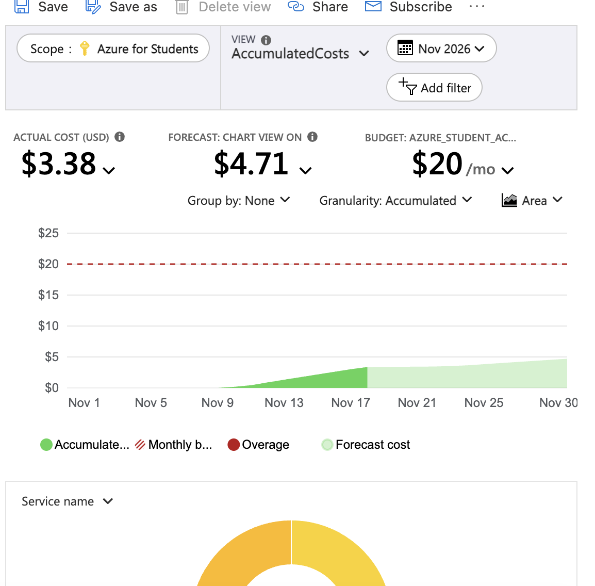

# Monthly cost and load model

The Azure CLI snapshot records two West US Linux Standard_B2pts_v2 VMs, one 32 GiB Standard SSD and one Standard static IPv4 per environment. It also records a user-configured monthly USD 20 Cost Management budget named `azure_student_account_monthly_budget`, with notifications at 50%, 80%, and 100% (USD 10, 16, and 20). This alert budget is not the Azure for Students credit balance and is not a spending cap. The snapshot does not include the remaining student credit. Azure for Students provides $100 in credit for up to 12 months per eligible activation, with renewal for active students; confirm the actual remaining balance and expiration in the Azure Sponsorships portal or Education Hub. The `currentSpend` field is a subscription-wide observation, can lag billing, and is not a project-only invoice. Notifications do not stop resources.

The submitted Azure Cost Management screenshot below shows the `Azure for Students` scope for November 2026, actual cost of USD 3.38, forecast of USD 4.71, and a USD 20/month budget. This is a point-in-time portal view. It proves the displayed budget and current/forecast cost at capture, but it does not show the remaining Azure for Students credit or its expiration date.

## Forecast in USD

These are modeled retail costs before applying any Azure for Students credit; they are not a statement of the student's out-of-pocket charge. Assume both sites run 730 hours. Each VM costs 730 × 0.010 = 7.30; each E4 disk costs 2.40; each IPv4 costs 730 × 0.005 = 3.65. Combined fixed cost: 2 × (7.30 + 2.40 + 3.65) = 26.70. Use the Linux VM retail meter; the separate Cloud Services meter returned in the raw query does not apply.

Use 10,000 combined visits per month at 1×, 200,000 origin egress bytes per visit after CDN hits (including API, SSE and cache fills), decimal GB, and one million baseline disk operations plus 20 per visit across both disks. Assume 120 vault secret reads per month from deployment, not per visit. Vault cost is 120 / 10,000 × 0.03 = 0.00036. Assume the subscription has its first 100 GB of monthly Internet egress available, then USD 0.087/GB. Disk operations use USD 0.002/10,000 before applicable billing caps. Round totals to cents.

| Traffic | Visits | Origin GB | Egress | Disk operations | Disk operations cost | Monthly total |
|---|---:|---:|---:|---:|---:|---:|
| 1× | 10,000 | 2 | 0.00 | 1,200,000 | 0.24 | 26.94 |
| 10× | 100,000 | 20 | 0.00 | 3,000,000 | 0.60 | 27.30 |
| 100× | 1,000,000 | 200 | 8.70 | 21,000,000 | 4.20 | 39.60 |

For example, 100× egress costs (200 − 100) × 0.087 = 8.70. The table excludes student-credit offsets, taxes, backups, paid telemetry, extra disks and VM upgrades. Database and application share each environment's VM. Cloudflare Free is assumed. Public board visitors do not require Auth0 accounts; assume at most 20 monthly active synthetic sign-ins. Assume one fixed route per environment, 24 successful cache refreshes per day per environment and one credit per short routing call: 48 credits/day vs the 3,000-credit daily free allowance. Outages, cold starts and simultaneous misses can increase calls. Paid add-ons and overages would change the estimate. The 1× retail estimate exceeds the configured USD 20 alert budget by USD 6.94 per full month; student credit may offset eligible charges, but the remaining balance was not captured.

## Capacity evidence and limits

On staging, twelve public trip-list GETs at concurrency one and twelve at concurrency four returned HTTP 200. See read-load.json for response bytes, times and batch wall times. Reproduce by requesting /api/trips?pageSize=5 twelve times with curl, first serially, then using four workers. This short read-only check does not establish sustained 100× capacity. With four origin requests per visit, one million visits over 30 days averages 1.54 requests/s; a tenfold peak is about 15.4 requests/s. Long-lived SSE connections also hold resources between HTTP requests. Before resizing, measure active SSE connections, memory, database latency and CPU credits under a representative peak. A second API replica also needs shared confirmation keys and a plan for per-process provider caches. Re-price the topology after any resize.

## Reproduction and sources

Run az consumption budget list and inspect amount, currentSpend and notification thresholds; omit contact addresses. For each resource group run az vm show, az disk list and az network public-ip list. The exact retail API query URLs and selected meter fields are in snapshot.json. Codex cross-checked the CLI disk-size field after the first projection returned null. The evidence excludes credentials, contact addresses and subscription IDs. A named budget is evidence of configuration; this check did not induce a paid budget threshold crossing.

[Azure for Students credit and usage](https://learn.microsoft.com/en-us/azure/education-hub/navigate-costs), [Azure bandwidth pricing](https://azure.microsoft.com/en-us/pricing/details/bandwidth/), [Azure retail API](https://learn.microsoft.com/en-us/rest/api/cost-management/retail-prices/azure-retail-prices), [Geoapify pricing](https://www.geoapify.com/pricing/), [Cloudflare Free](https://www.cloudflare.com/plans/free/).
