# F2 — Remote-call loading, empty, and error states

This page gathers the F2 browser screenshots in one place. The PNG files are stored with the evidence in this project, and the relative image embeds below display them in Markdown viewers that support inline images.

The public-page screenshots use synthetic responses intercepted by Playwright. They show loading, forced HTTP 503 failures, recovery, and an empty result. The operator screenshots show sign-in, dispatch-write, and live-update states. These are local browser checks; the trips, identities, and responses are synthetic.

Test sources: [`public-recovery.spec.ts`](../../frontend/tests/public-recovery.spec.ts) and [`operator-states.spec.ts`](../../frontend/tests/operator-states.spec.ts). Evidence notes: [`public-board-states`](public-board-states/README.md) and [`operator-states`](operator-states/README.md).

## Public board and route reference

### Loading

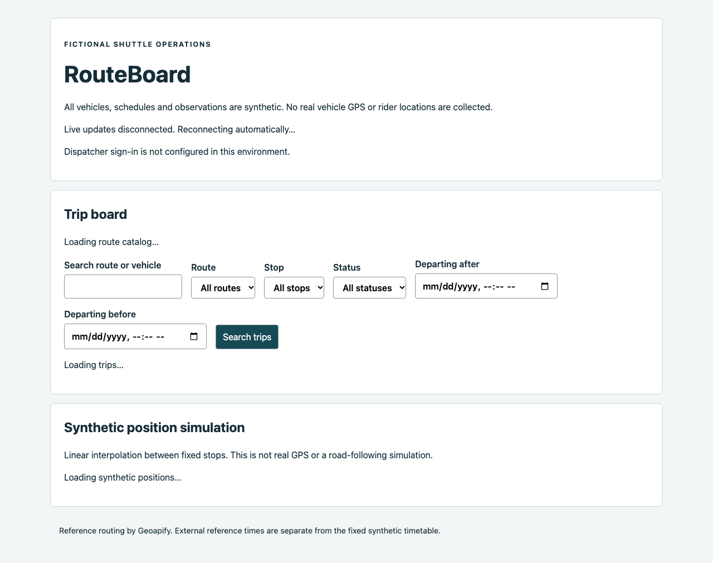

### Forced failures

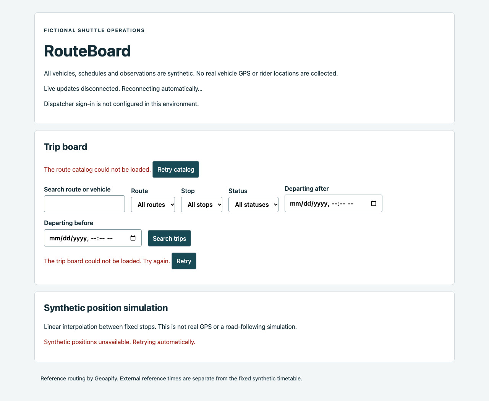

### Empty state after recovery

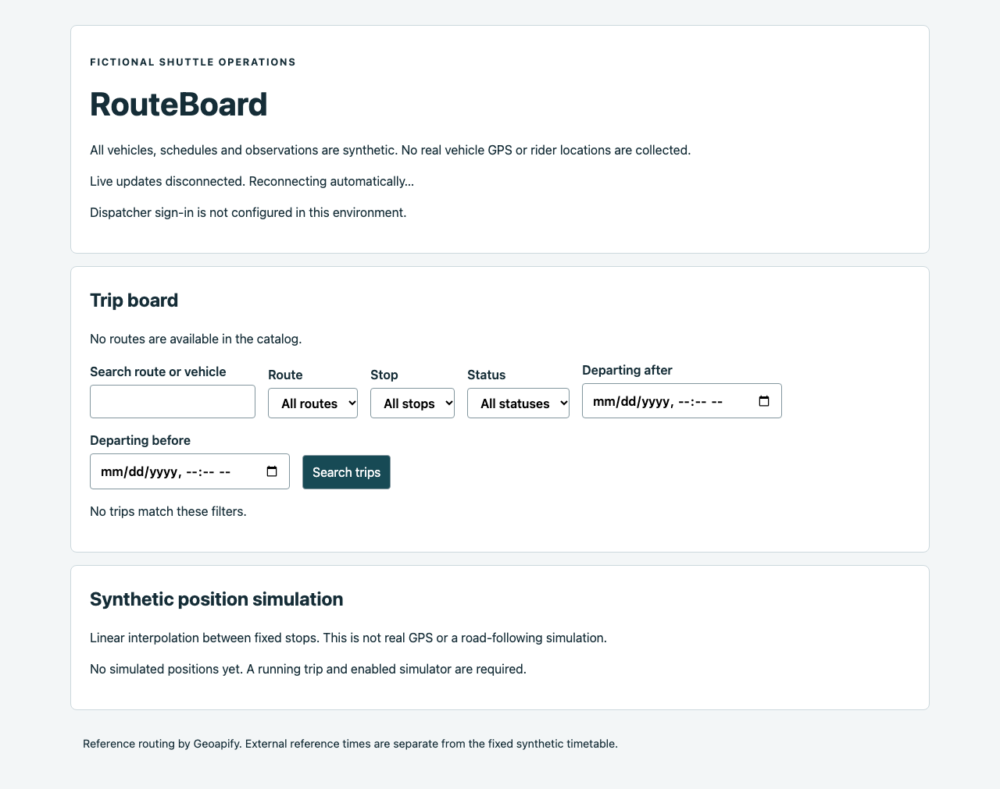

### Route reference loading

### Route reference failure

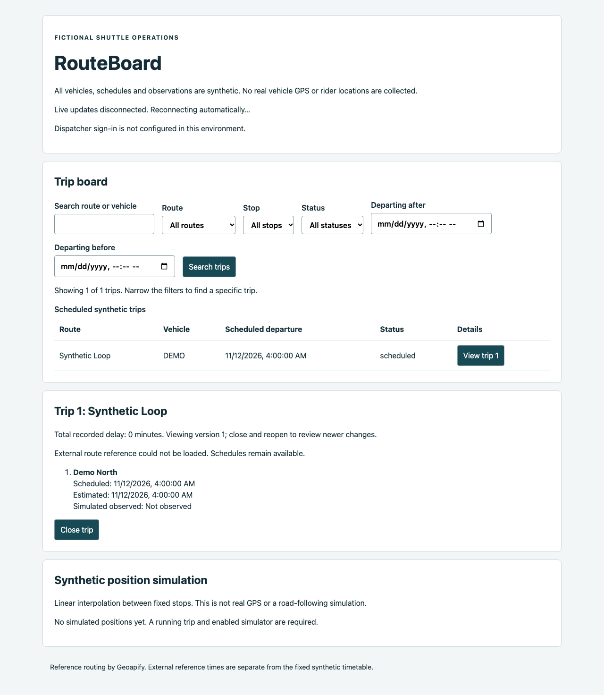

### Route reference recovery

## Sign-in, dispatch, and live connection

### Sign-in progress

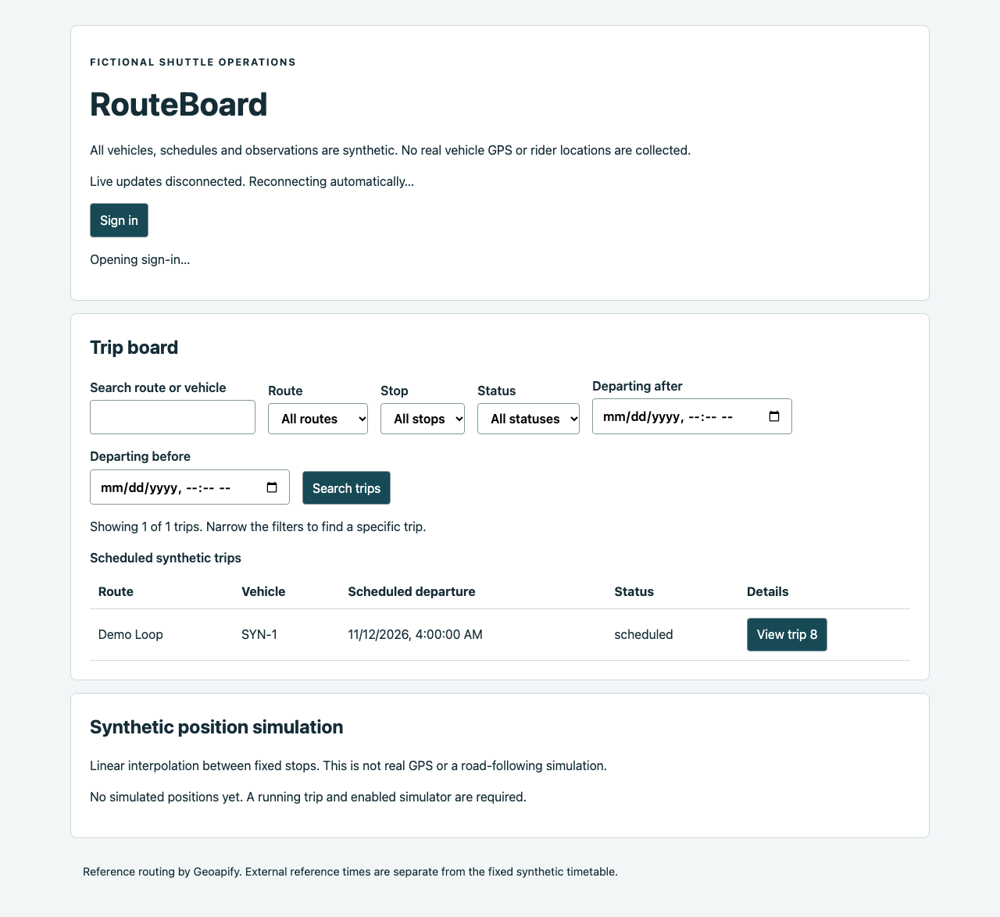

### Sign-in error and retry

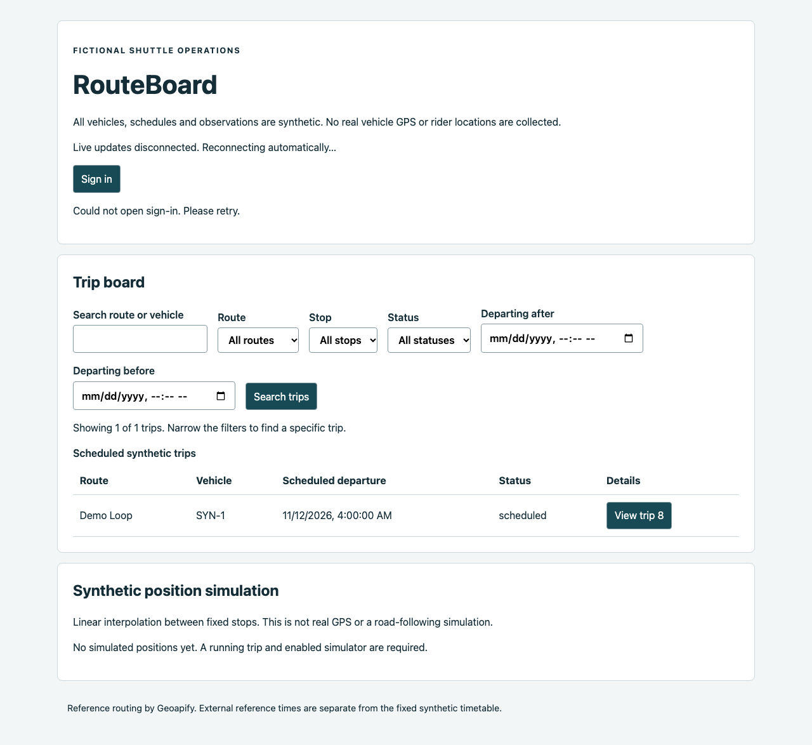

### Dispatch write in progress

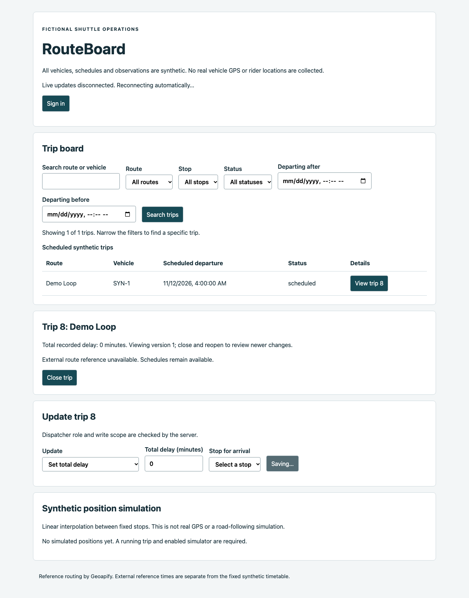

### Dispatch write denied

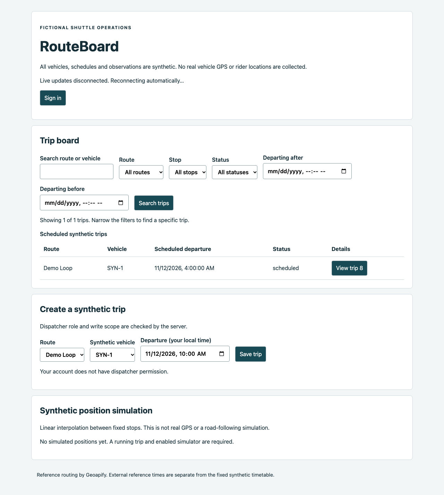

### Stale update conflict

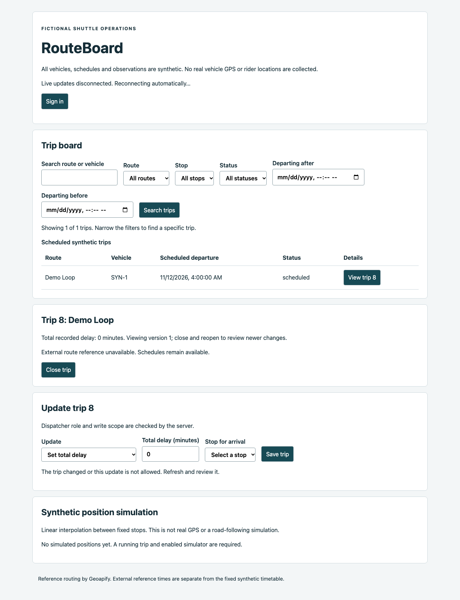

### Live updates disconnected

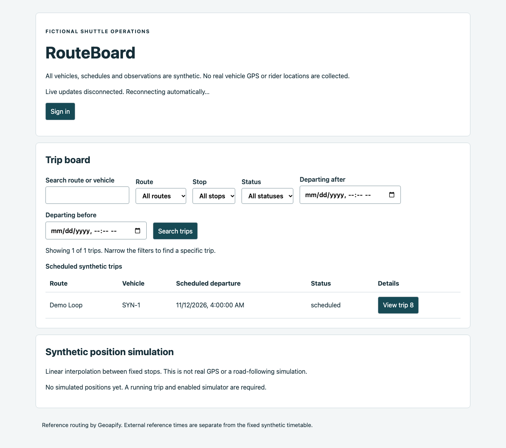

### Live updates reconnected

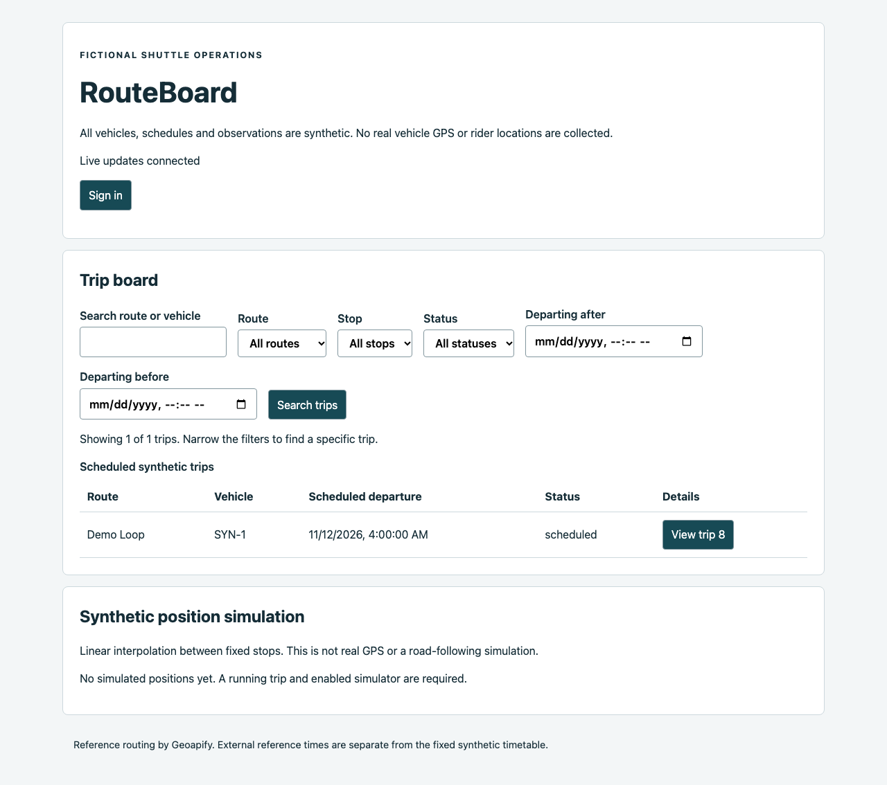
